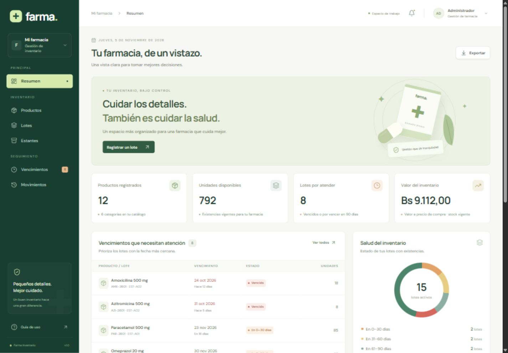

# Farma · Inventario de farmacia

Aplicación web en español para administrar productos, estantes, lotes, existencias y vencimientos. Frontend **React**, API REST **Node.js + Express**, persistencia **Microsoft SQL Server**. Los datos se guardan realmente en SQL Server; no se usa almacenamiento del navegador ni una base simulada.



## Ejecución rápida en Windows

Requisitos: Node.js 22 o superior, SQL Server 2019+ en ejecución y Microsoft ODBC Driver 18. La configuración inicial usa autenticación de Windows en la instancia local predeterminada.

```powershell
npm install
npm run setup
npm run dev
```

Abrir [http://localhost:5173](http://localhost:5173).

Credenciales iniciales de demostración:

- Correo: `admin@farma.local`
- Contraseña: `Farma2026!`

`npm run setup` crea `backend/.env` con una clave aleatoria de sesión, crea la base `FarmaInventario`, aplica el esquema, inserta datos ilustrativos y registra el administrador. El script es idempotente: una nueva ejecución conserva los registros existentes. Cambia `ADMIN_PASSWORD` **antes de la primera instalación** si quieres una contraseña diferente. El script no modifica la contraseña de usuarios que ya existen.

Para personalizar la conexión, copia primero `backend/.env.example` a `backend/.env`, configura las variables y ejecuta `npm run setup`. Define también un `JWT_SECRET` aleatorio de al menos 32 caracteres si creas el archivo manualmente.

```powershell
Copy-Item backend/.env.example backend/.env
# Editar backend/.env antes de continuar
npm run setup
```

Instalación sin datos de demostración:

```powershell
npm run setup -w backend -- --no-demo
```

## Funciones

| Módulo       | Funcionalidad                                                                                                                             |
| ------------ | ----------------------------------------------------------------------------------------------------------------------------------------- |
| Resumen      | Indicadores reales, valor de compra del inventario vigente, lotes prioritarios, stock bajo y distribución por categoría.                  |
| Productos    | Registrar, listar, buscar, editar y eliminar; nombre, descripción, categoría, compra, venta y stock mínimo.                               |
| Estantes     | CRUD completo; código único, nombre, ubicación, descripción; consulta de lotes almacenados.                                               |
| Lotes        | Varios lotes por producto; número, fechas de ingreso y vencimiento, cantidad y estante; edición, ajustes y eliminación con restricciones. |
| Vencimientos | Detección automática, filtros excluyentes para vencidos, 0–30, 31–60, 61–90 días y vigentes a más de 90 días.                             |
| Movimientos  | Historial persistente de entradas, ajustes, edición y eliminación de lotes con responsable, fecha y motivo.                               |
| Acceso       | Contraseñas con bcrypt, sesión JWT en cookie HttpOnly y cierre de sesión.                                                                 |
| Interfaz     | Diseño adaptable a escritorio y móvil, búsqueda, filtros, paginación, exportación CSV, estados vacíos y mensajes de error.                |

## Reglas del inventario

- La fecha comercial usa `America/La_Paz` (UTC−4), tanto en SQL como en la interfaz. Las fechas de los lotes son de tipo `DATE`, sin conversión accidental por zona horaria.
- Un lote está vencido cuando su fecha es **anterior a hoy**. Si vence hoy pertenece al rango 0–30 días y sigue vigente durante ese día.
- Los rangos son excluyentes: vencido `< 0`; primera alerta `0–30`; segunda `31–60`; tercera `61–90`; vigente sin alerta `> 90` días.
- Las alertas solo consideran lotes con unidades. Se calculan al consultar SQL Server; no requieren tareas programadas. La interfaz actualiza los datos cada 60 segundos.
- El stock utilizable y el valor del inventario excluyen lotes vencidos. El valor usa el precio de compra actual del producto; no representa un historial contable de costos por lote.
- Stock bajo significa `stock utilizable < stock mínimo`. Con mínimo 0 no hay alerta de reposición.
- El número de lote es único **por producto**. El código del estante es único.
- No se eliminan productos ni estantes asociados a lotes. No se elimina un lote con existencias: se debe ajustar a cero indicando el motivo. El historial sobrevive a su eliminación.
- El producto de un lote no se cambia después del registro. La cantidad solo se modifica con ajustes auditados. Las transacciones y bloqueos impiden salidas simultáneas que dejen stock negativo.
- Se permite registrar lotes históricos vencidos para reconciliar existencias; aparecen inmediatamente en las alertas y se excluyen del stock utilizable. No se admiten ingresos futuros.
- Los precios admiten cero y hasta dos decimales. Se permite una venta por debajo del costo: el examen no exige restringirla.

## Conexión a SQL Server

### Autenticación integrada de Windows

```dotenv
DB_AUTH=windows
DB_SERVER=localhost
DB_PORT=
DB_NAME=FarmaInventario
DB_ODBC_DRIVER=ODBC Driver 18 for SQL Server
DB_ENCRYPT=false
DB_TRUST_CERTIFICATE=true
```

Para SQL Express usa `DB_INSTANCE=SQLEXPRESS` y deja `DB_PORT` vacío. Habilita TCP/IP en SQL Server Configuration Manager y reinicia la instancia si no acepta conexiones. Una instancia nombrada puede necesitar SQL Server Browser; también puedes usar un puerto TCP fijo con `DB_INSTANCE` vacío.

La identidad de Windows que ejecuta Node necesita permiso para crear la base durante la instalación. En ejecución normal basta con acceso a sus tablas y vistas; evita usar una cuenta de administrador de SQL Server en un despliegue real.

### Usuario y contraseña (Windows, Linux o Docker)

```dotenv
DB_AUTH=sql
DB_SERVER=localhost
DB_PORT=1433
DB_NAME=FarmaInventario
DB_USER=sa
DB_PASSWORD=TuClaveDeSQLServer
DB_ENCRYPT=false
DB_TRUST_CERTIFICATE=true
```

`msnodesqlv8` es opcional y solo se utiliza para autenticación integrada; las conexiones SQL usan `mssql` con Tedious. Para producción configura TLS con `DB_ENCRYPT=true`, un certificado válido y `DB_TRUST_CERTIFICATE=false`.

### SQL Server con Docker (opcional)

Si ya tienes una instancia local en el puerto 1433, úsala o cambia el puerto publicado del contenedor.

```powershell
$env:MSSQL_SA_PASSWORD='UnaClaveSQLSegura2026!'
docker compose up -d
```

Configura `backend/.env` con `DB_AUTH=sql` y esa contraseña. Espera a que SQL Server termine de iniciar y luego ejecuta `npm run setup`. El volumen conserva los datos al reiniciar el contenedor.

### Scripts SQL para entrega

1. `database/00-create-database.sql`: creación de la base.
2. `database/01-schema.sql`: tablas, restricciones, claves, índices y vistas.
3. `database/02-demo-data.sql`: datos de demostración con fechas relativas.

También puedes ejecutarlos desde SSMS, en ese orden y sobre la misma base. El administrador se crea con `npm run setup`, que genera el hash bcrypt; los scripts no guardan contraseñas en texto plano en SQL.

## Compilación y ejecución

```powershell
npm run build
npm start
```

Express sirve la aplicación compilada y la API en [http://127.0.0.1:3001](http://127.0.0.1:3001). No se necesita Vite en este modo. El servidor se enlaza a la interfaz local para la demostración.

Para desplegar en un servidor, configura un proxy inverso HTTPS, un origen de cliente adecuado y `NODE_ENV=production`. Las cookies de producción son `Secure` y requieren HTTPS. Mantén `.env` fuera del repositorio y cambia la contraseña inicial antes del primer uso real.

## Pruebas

```powershell
npm test
npm run test:integration
npm run build
```

Las pruebas unitarias cubren límites de vencimiento, fechas inválidas, precisión monetaria y validación de ajustes. Las pruebas de integración usan **la base SQL Server configurada**, crean sus propios registros `QA-*` y los limpian al terminar. Verifican autenticación, CRUD, claves duplicadas, relaciones, los ocho límites de vencimiento, historial y dos salidas concurrentes. Requieren haber ejecutado `npm run setup`.

El flujo de GitHub Actions valida las pruebas unitarias y la compilación en Linux. Las pruebas de integración se ejecutan localmente contra SQL Server y no están simuladas en CI.

## Estructura

```text
backend/
  src/           API, conexión, autenticación y reglas de negocio
  scripts/       Instalación de base y administrador
  test/          Pruebas unitarias y de integración
  .env.example   Variables de conexión, sin secretos reales
frontend/
  src/           Aplicación React, cliente REST y estilos
  public/        Favicon
database/        Scripts de SQL Server
docs/            Modelo de datos y referencia de la API
.github/         Validación automática
compose.yaml     SQL Server opcional en Docker
```

## Publicar en GitHub

El proyecto debe subirse con `backend`, `frontend`, `database` y `package-lock.json`. No subas `node_modules`, `.env` ni las compilaciones.

```powershell
git init -b main
git add .
git commit -m "Sistema de inventario de farmacia con React, Express y SQL Server"
git remote add origin https://github.com/TU_USUARIO/TU_REPOSITORIO.git
git push -u origin main
```

Si el repositorio local ya está inicializado, omite `git init`. La publicación requiere tu cuenta de GitHub y un repositorio de destino.

**Decisión de tecnología:** se utiliza solo SQL Server por la elección expresa del solicitante. El enunciado menciona MySQL en los requisitos técnicos y también admite SQL Server en la observación final; no se incluye un segundo motor.
