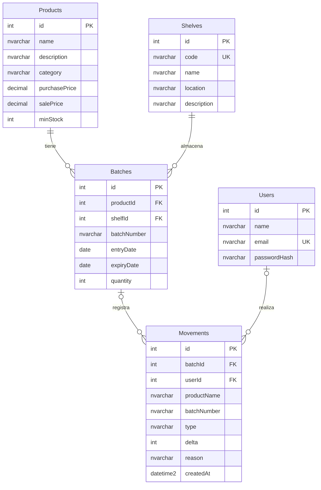

# Modelo de datos

La combinación `(productId, batchNumber)` es única. Las claves foráneas de productos y estantes impiden eliminaciones con referencias. Al borrar un lote sin stock, `Movements.batchId` pasa a `NULL` y se conservan el nombre del producto y número de lote como instantánea histórica.

Las vistas `vBatches` y `vProducts` calculan el vencimiento, el stock vigente y la próxima fecha de vencimiento desde los registros reales. No se guarda una copia desactualizada del total de stock ni del estado de alerta.

`DATETIME2` almacena los eventos en UTC; las fechas comerciales de lote usan `DATE`. Los precios usan `DECIMAL(10,2)` y las cantidades `INT` con restricciones de no negatividad. Los índices cubren vencimiento, estante y orden del historial.
